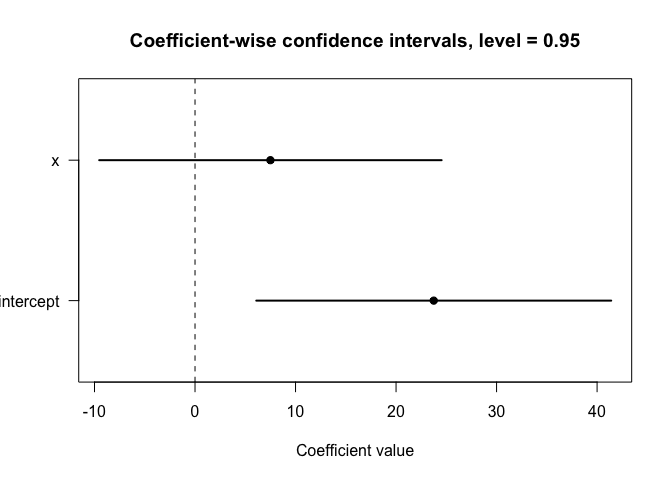
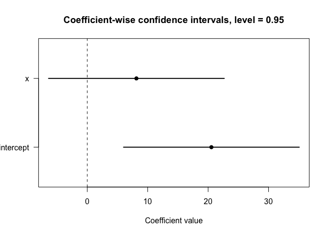
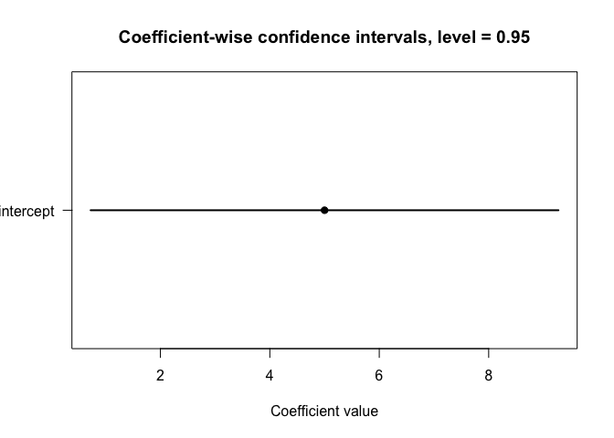

<!-- README.md is generated from README.Rmd. Please edit that file -->

# qonlyreg

<!-- badges: start -->

<!-- badges: end -->

## Overview

`qonlyreg` provides methods for regression analysis when only grouped
summary statistics of the outcome distribution are available.

The package implements estimation, partial identification, and inference
procedures for linear regression models when researchers observe
disclosed quantiles, reported means, or mixed disclosure rather than
individual-level outcomes.

The methodology is particularly useful in settings where:

- only grouped quantile summaries are publicly available,
- privacy restrictions prevent disclosure of microdata,
- published statistics report medians, percentiles, ranges, or means,
- treatment and control arms are reported only through summary
  statistics,
- the outcome distribution is only partially observed.

The package currently supports:

- quantile-only linear regression,
- mixed disclosure with quantiles and observed means,
- group-specific quantile grids,
- construction of sharp bounds for conditional means,
- partial identification under coarse quantile disclosure,
- simultaneous confidence regions,
- treatment-control contrast bounds and confidence regions for two-arm
  studies and meta-analysis applications.

## Installation

You can install the development version of `qonlyreg` from GitHub:

``` r
# install.packages("remotes")
remotes::install_github("masaiwasawa/qonlyreg")
```

## Usage

`qlm()` computes a linear regression estimator using reconstructed group
means. For groups with quantile disclosure, the quantile function is
approximated by piecewise linear interpolation and the group mean is
obtained by integrating the resulting quantile function. For groups with
observed means, the reported mean is used directly.

`qlm_bounds()` constructs sharp bounds for group conditional means under
known support restrictions.

`qlm_region()` constructs a simultaneous confidence region under partial
identification with a fixed number of disclosed quantiles or mixed
disclosure. Coefficient-wise confidence intervals are obtained by
projecting this region using `confint()`.

`qlm_contrast_bounds()` and `qlm_contrast_region()` extend these tools
to treatment-control contrasts, which are common in two-arm studies and
meta-analysis applications.

`qlm_contrast_bounds()` constructs sharp bounds for treatment-control
mean contrasts.

`qlm_contrast_region()` constructs simultaneous confidence regions for
treatment-control contrasts and is particularly useful in meta-analysis
and two-arm study applications.

For point estimation of treatment-control contrasts, users can first
construct study-level mean differences and their standard errors from
the arm-level summaries, and then apply `qlm()` by treating these
differences as observed means.

### Support bounds and covariance estimation

For quantile-only disclosures, `y_lower_bound` and `y_upper_bound`
specify known bounds on the conditional outcome support, which need not
coincide with its actual endpoints. When the exact support endpoints are
known, they can instead be supplied through `y_lower` and `y_upper`.

To construct simultaneous confidence regions, `qlm_region()` and
`qlm_contrast_region()` estimate the sampling covariance matrix of the
estimated lower and upper mean bounds. For quantile-only groups, this
requires estimating the densities at the disclosed quantiles. The
functions use finite differences of the disclosed sample quantiles to
estimate quantile-function derivatives, whose reciprocals provide
density estimates. Exact support endpoints can be used as additional
nodes in these finite differences, whereas general support bounds are
not used there.

When no exact support endpoint is available, at least two disclosed
quantiles are required to compute the finite-difference covariance
estimator. With a single disclosed quantile, at least one exact endpoint
is required.

For the finite-difference covariance estimator used here, asymptotically
valid inference generally requires increasing group sample sizes and an
increasingly dense grid of disclosed quantiles, under appropriate
regularity and rate conditions.

## Examples

The following example illustrates the basic workflow of the package.

In the examples, `y_lower` and `y_upper` are assumed to be the exact
endpoints of the conditional outcome support. When only bounds on the
support are known, users should instead specify `y_lower_bound` and
`y_upper_bound`.

### Basic example

``` r
library(qonlyreg)

tau <- c(0.25, 0.5, 0.75)

qhat <- rbind(
  c(10, 15, 20),
  c(20, 25, 30),
  c(30, 35, 40)
)

X <- cbind(
  intercept = 1,
  x = c(0, 1, 2)
)

n_g <- c(100, 120, 150)

## Point estimation
fit <- qlm(
  qhat = qhat,
  tau = tau,
  X = X,
  n_g = n_g
)

summary(fit)
#> Quantile/mean disclosure linear model
#> 
#> Call:
#> qlm(qhat = qhat, tau = tau, X = X, n_g = n_g)
#> 
#> Coefficients:
#>                    Std.Error                     
#> intercept 15.00000   0.65192 23.009 < 2.2e-16 ***
#> x         10.00000   0.46734 21.398 < 2.2e-16 ***
#> ---
#> Signif. codes:  0 '***' 0.001 '**' 0.01 '*' 0.05 '.' 0.1 ' ' 1

## Mean bounds
bounds <- qlm_bounds(
  qhat = qhat,
  tau = tau,
  y_lower = 0,
  y_upper = 100
)

bounds
#> Quantile/mean disclosure mean bounds
#> 
#>   m_lower m_upper
#> 1   11.25   36.25
#> 2   18.75   43.75
#> 3   26.25   51.25

## Simultaneous confidence region
region <- qlm_region(
  qhat = qhat,
  tau = tau,
  X = X,
  n_g = n_g,
  y_lower = 0,
  y_upper = 100,
  B = 1000
)

summary(region)
#> Quantile/mean disclosure simultaneous confidence region
#> 
#> Call:
#> qlm_region(qhat = qhat, tau = tau, X = X, n_g = n_g, y_lower = 0, 
#>     y_upper = 100, B = 1000)
#> 
#> Confidence level: 0.95 
#> Critical value: 2.408954 
#> 
#> Adjusted group mean constraints:
#>      lower    upper
#> 1  6.09567 41.40433
#> 2 14.24158 48.25842
#> 3 22.33931 55.16069

ci <- confint(region)
ci
#> Quantile/mean disclosure coefficient-wise confidence intervals
#> 
#> Confidence level: 0.95 
#> Critical value: 2.408954 
#> 
#>               lower    upper
#> intercept  6.095670 41.40433
#> x         -9.532509 24.53251
plot(ci)
```



### Mixed disclosure example

The `disclosure` interface allows different groups to report different
summary statistics.

``` r
disclosure <- data.frame(
  group = c(
    1, 1, 1,
    2,
    3, 3, 3
  ),
  type = c(
    "quantile", "quantile", "quantile",
    "mean",
    "quantile", "quantile", "quantile"
  ),
  tau = c(
    0.25, 0.50, 0.75,
    NA,
    0.25, 0.50, 0.75
  ),
  value = c(
    10, 15, 20,
    25,
    30, 35, 40
  ),
  n = c(
    100, 100, 100,
    120,
    150, 150, 150
  ),
  se = c(
    NA, NA, NA,
    1.5,
    NA, NA, NA
  )
)

X <- cbind(
  intercept = 1,
  x = c(0, 1, 2)
)

## Point estimation
fit <- qlm(
  disclosure = disclosure,
  X = X
)
#> Mixed disclosure detected: quantile, mean.

summary(fit)
#> Quantile/mean disclosure linear model
#> 
#> Call:
#> qlm(X = X, disclosure = disclosure)
#> 
#> Coefficients:
#>                    Std.Error                     
#> intercept 15.00000   0.84508 17.750 < 2.2e-16 ***
#> x         10.00000   0.47585 21.015 < 2.2e-16 ***
#> ---
#> Signif. codes:  0 '***' 0.001 '**' 0.01 '*' 0.05 '.' 0.1 ' ' 1

## Mean bounds
bounds <- qlm_bounds(
  disclosure = disclosure,
  y_lower = 0,
  y_upper = 100
)

bounds
#> Quantile/mean disclosure mean bounds
#> 
#>   m_lower m_upper
#> 1   11.25   36.25
#> 2   25.00   25.00
#> 3   26.25   51.25

## Simultaneous confidence region
region <- qlm_region(
  disclosure = disclosure,
  X = X,
  y_lower = 0,
  y_upper = 100,
  B = 1000
)
#> Mixed disclosure detected: quantile, mean.

summary(region)
#> Quantile/mean disclosure simultaneous confidence region
#> 
#> Call:
#> qlm_region(X = X, y_lower = 0, y_upper = 100, disclosure = disclosure, 
#>     B = 1000)
#> 
#> Confidence level: 0.95 
#> Critical value: 2.449613 
#> 
#> Adjusted group mean constraints:
#>       lower    upper
#> 1  6.008672 41.49133
#> 2 21.325580 28.67442
#> 3 22.273306 55.22669

ci <- confint(region)
ci
#> Quantile/mean disclosure coefficient-wise confidence intervals
#> 
#> Confidence level: 0.95 
#> Critical value: 2.449613 
#> 
#>               lower    upper
#> intercept  6.008672 35.07553
#> x         -6.401114 22.66575
plot(ci)
```



### Treatment-control contrast example

The package also supports treatment-control comparisons, which are
common in two-arm studies and meta-analysis applications.

``` r
arm_disclosure <- data.frame(
  study = c(
    1, 1, 1,
    1, 1, 1,
    2,
    2
  ),
  arm = c(
    "case", "case", "case",
    "control", "control", "control",
    "case",
    "control"
  ),
  type = c(
    "quantile", "quantile", "quantile",
    "quantile", "quantile", "quantile",
    "mean",
    "mean"
  ),
  tau = c(
    0.25, 0.50, 0.75,
    0.25, 0.50, 0.75,
    NA,
    NA
  ),
  value = c(
    10, 15, 20,
    8, 12, 16,
    25,
    20
  ),
  n = c(
    100, 100, 100,
    100, 100, 100,
    120,
    120
  ),
  se = c(
    NA, NA, NA,
    NA, NA, NA,
    1.5,
    1.2
  )
)


## Contrast bounds
contrast_bounds <- qlm_contrast_bounds(
  disclosure = arm_disclosure,
  treatment = "case",
  control = "control",
  y_lower = 0,
  y_upper = 100
)

contrast_bounds
#> Treatment-control contrast bounds
#> 
#>   id theta_lower theta_upper
#> 1  1      -22.75       27.25
#> 2  2        5.00        5.00

X_contrast <- matrix(1, nrow = 2, ncol = 1)
colnames(X_contrast) <- "intercept"

## Contrast confidence region
contrast_region <- qlm_contrast_region(
  disclosure = arm_disclosure,
  X = X_contrast,
  treatment = "case",
  control = "control",
  y_lower = 0,
  y_upper = 100,
  B = 1000
)

summary(contrast_region)
#> Quantile/mean disclosure simultaneous confidence region
#> 
#> Call:
#> qlm_contrast_region(disclosure = arm_disclosure, X = X_contrast, 
#>     treatment = "case", control = "control", y_lower = 0, y_upper = 100, 
#>     B = 1000)
#> 
#> Confidence level: 0.95 
#> Critical value: 2.225622 
#> 
#> Adjusted group mean constraints:
#>         lower     upper
#> 1 -29.4806675 33.980668
#> 2   0.7247194  9.275281

ci <- confint(contrast_region)
ci
#> Quantile/mean disclosure coefficient-wise confidence intervals
#> 
#> Confidence level: 0.95 
#> Critical value: 2.225622 
#> 
#>               lower    upper
#> intercept 0.7247194 9.275281
plot(ci)
```



## Citation

If you use `qonlyreg`, please cite:

Iwasawa, M. and Nakanishi, H. (2026). *Quantile-Only Regression:
Inference and Partial Identification under Quantile Disclosure*.
Unpublished manuscript.
