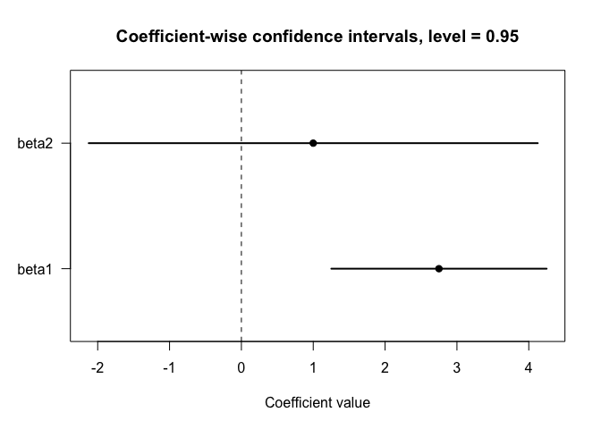

<!-- README.md is generated from README.Rmd. Please edit that file -->

# qonlyreg

<!-- badges: start -->

<!-- badges: end -->

## Overview

`qonlyreg` provides methods for regression analysis when only quantile
summaries of the outcome distribution are available.

The package implements estimation and inference procedures for
regression models based on disclosed quantiles rather than
individual-level observations or conditional means.

The methodology is particularly useful in settings where:

- only grouped quantile summaries are publicly available,
- privacy restrictions prevent disclosure of microdata,
- published statistics report quantiles instead of means,
- the outcome distribution is only partially observed.

The package currently supports:

- quantile-only linear regression,
- construction of sharp bounds for conditional means,
- asymptotic inference under increasing quantile disclosure.
- partial identification under coarse quantile disclosure,
- simultaneous confidence regions,

The theoretical framework is based on quantile-function restrictions and
asymptotic results for quantile-only regression.

## Installation

You can install the development version of `qonlyreg` from GitHub:

``` r
# install.packages("remotes")
remotes::install_github("masaiwasawa/qonlyreg")
```

## Example

The following example illustrates the basic workflow of the package:

``` r
library(qonlyreg)

tau <- c(0.25, 0.5, 0.75)

qhat <- matrix(
  c(
    1.0, 2.0, 3.0,
    2.0, 3.0, 5.0
  ),
  nrow = 2,
  byrow = TRUE
)

X <- cbind(1, c(0, 1))

n_g <- c(100, 100)


## Sharp bounds for conditional means
bounds <- qlm_bounds(
  qhat = qhat,
  tau = tau,
  y_lower = 0,
  y_upper = 10
)

bounds
#> Quantile-only mean bounds
#> 
#>   m_lower m_upper
#> 1     1.5       4
#> 2     2.5       5


## Quantile-only regression
fit <- qlm(
  qhat = qhat,
  tau = tau,
  X = X,
  n_g = n_g
)
summary(fit)
#> Quantile-only linear model
#> 
#> Call:
#> qlm(qhat = qhat, tau = tau, X = X, n_g = n_g)
#> 
#> Coefficients:
#>      Estimate Std.Error z.value   p.value    
#> [1,]  2.00000   0.14577 13.7199 < 2.2e-16 ***
#> [2,]  1.37500   0.26546  5.1797 2.222e-07 ***
#> ---
#> Signif. codes:  0 '***' 0.001 '**' 0.01 '*' 0.05 '.' 0.1 ' ' 1


## Simultaneous confidence region
region <- qlm_region(
  qhat = qhat,
  tau = tau,
  X = X,
  n_g = n_g,
  y_lower = 0,
  y_upper = 10,
  level = 0.95,
  B = 1000
)
summary(region)
#> Quantile-only simultaneous confidence region
#> 
#> Call:
#> qlm_region(qhat = qhat, tau = tau, X = X, n_g = n_g, y_lower = 0, 
#>     y_upper = 10, level = 0.95, B = 1000)
#> 
#> Confidence level: 0.95 
#> Critical value: 2.221278 
#> 
#> Adjusted group mean constraints:
#>      lower    upper
#> 1 1.251654 4.248346
#> 2 2.123364 5.376636

ci <- confint(region)
ci
#> Quantile-only coefficient-wise confidence intervals
#> 
#> Confidence level: 0.95 
#> Critical value: 2.221278 
#> 
#>           lower    upper
#> beta1  1.251654 4.248346
#> beta2 -2.124982 4.124982
plot(ci)
```



In this simple example, the quantile summaries are specified directly,
so no true regression parameter is defined.

The confidence region should be interpreted as a set of coefficient
values consistent with the disclosed quantiles and sampling uncertainty,
rather than as a conventional confidence interval centered at the point
estimate.

`qlm()` computes a quantile-only linear regression estimator and reports
standard errors, z-statistics, and p-values based on the asymptotic
approximation as the sample size and the number of disclosed quantiles
increase.

`qlm_region()` constructs a simultaneous confidence region under partial
identification with a fixed number of disclosed quantiles.
Coefficient-wise confidence intervals are obtained by projecting this
region using `confint()`.

## References

If you use `qonlyreg`, please cite:

Iwasawa, M. and Nakanishi, H. (2026). *Quantile-Only Regression:
Inference and Partial Identification under Quantile Disclosure*. Working
paper.
